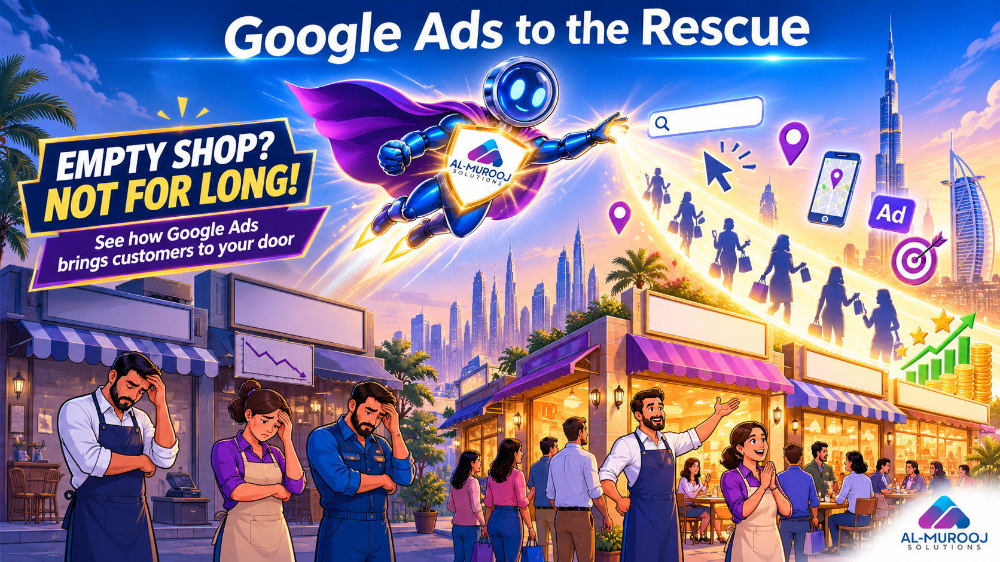

# Google Ads Agency Dubai: What to Ask Before You Hire One

> **Summary:** Looking for a Google Ads agency Dubai businesses can compare? Get the questions to ask, what to expect, and three recent Google changes.

Not sure how to pick a [Google Ads agency Dubai](https://almuroojsolutions.com/top-google-ads-agency-dubai) businesses can rely on? Ask it to explain, in plain words, how it builds campaigns, what it tracks, and how it reports, because clear answers beat big promises. Google Ads is Google’s advertising platform, where you usually pay per click (PPC). What should a [Google Ads marketing agency](https://almuroojsolutions.com/top-google-ads-agency-dubai) actually do for you?

It should plan campaigns around your goals, pick keywords, write ads, manage bids, and report results in numbers you understand. Google Ads, formerly Google AdWords, covers Search, Display, and Video, so the first question is where your customers actually look. One limit worth knowing: paid ads stop showing when the budget does.

Good Google Ads management Dubai advertisers can count on also means clear ownership. Ask who builds the campaigns, who watches them daily, and whether the ad account stays in your name. In my view, settle account ownership first, because it decides what you keep if you ever switch providers.

---

## Which Recent Google Changes Matter to a Dubai Advertiser?

* **Smart Bidding Learning Status (October 2026):** Google updated its Smart Bidding help page, and Search Engine Roundtable reported the rewrite on 21 October 2026. Smart Bidding is Google’s automated bidding, which sets bids using conversion data—meaning recorded actions such as calls, forms, or sales. Google Ads Help now says the Learning status never lasts more than seven days, though performance can take one to two conversion cycles to settle. My reading: ask your agency whether a slow patch reflects the label or a longer conversion cycle, since they’re different things. The page names no country limits, so I’d expect it to apply in the UAE.
* **November 2026 Core Update:** Google began rolling out its November 2026 core update on 10 November, according to Search Engine Land, and Search Engine Roundtable relayed Google’s estimate of about two weeks. Core updates are broad changes to Google’s search algorithms, so watch organic traffic and ad results side by side. The reports don’t limit it to particular countries.
* **Google Ads Data Manager Hashing Change (16 November 2026):** PPC Land reported on 18 October that Google emailed advertisers that Google Ads Data Manager will stop requiring SHA-256 hashed customer data from 16 November 2026, accepting encrypted data by default. This is a third-party report of that email, and I found no Google help page announcing it, so check your account before relying on the date. It matters if an agency uploads your customer lists, and the report names no country limits.

---

## Which Questions Should You Put to Every Provider?

When you compare PPC services Dubai providers advertise, ask each one the same questions:

1. Who owns the ad account, and will you have full access?
2. Which campaign types will you use, and why?
3. How will calls, forms, and sales be tracked as conversions?
4. How will campaigns handle Arabic and English searches, and calls or WhatsApp enquiries?
5. What will each report show, how often, and who explains it?
6. When do you change bids or budgets, and what do you check first?

> **General illustration (not a real client):** A furniture showroom that counts only clicks—not calls or orders—can’t tell which ads are working.

---

## How Do You Compare Providers Fairly?

Ask for a sample report, check the answers against the list above, and note who responds clearly. Treat a provider’s own figures as claims until you can see how they were measured.

[Al Murooj Solutions](https://almuroojsolutions.com) is one example worth a look. According to the company’s website, it has 13+ years of experience in Dubai, displays a Google Partner badge, and lists The Marina Gym as a case study covering SEO, Google Ads, and social media. Its page on [Google Ads management in Dubai](https://almuroojsolutions.com/top-google-ads-agency-dubai) sets out the service in more detail. In my view, that’s enough to earn it a place on a shortlist, not a verdict.

Before you decide, compare several providers and write down your main goal first—whether that’s phone calls, form enquiries, or online sales. Clear answers to the questions above will tell you more than any slogan.
